# PBL6 — Tổng quan hiện trạng và chuẩn bị báo cáo cuối đợt

Ngày cập nhật 25/11/2026.

Tài liệu phục vụ buổi học và báo cáo tiến độ cuối đợt với giảng viên. Nội dung tập trung vào những gì đã triển khai, kết quả đang có, vấn đề còn tồn tại và cách trình bày trung thực.

## 1. Tóm tắt để nắm nhanh trước buổi báo cáo

Đồ án giải quyết bài toán phân vùng tổn thương nhồi máu não trên ảnh MRI 3D của ISLES-2022. Nhánh thực nghiệm được đối chiếu trong tài liệu sử dụng hai đầu vào DWI và ADC, với đầu ra là mask tổn thương nhị phân. Đã có mã xử lý dữ liệu, mô hình, huấn luyện, suy luận cửa sổ trượt, đánh giá theo bệnh nhân và theo từng ổ tổn thương.

Kết quả đối chứng rõ nhất hiện có là Fold 0 trên bộ 250 ca, chia 200 ca train và 50 ca validation. V3 đạt mean validation Dice khoảng **0,6779**. V4-Fixed đạt **0,6837**, đồng thời làm tăng false positives và giảm lesion F1 ở chế độ raw. Cải thiện Dice này chưa đủ để kết luận V4 tốt hơn về khả năng phát hiện tổn thương.

Các lượt thử kéo dài và chẩn đoán tiếp theo vẫn quanh mức best Dice **0,68–0,686**. Có lượt suy giảm rõ sau khi đạt best checkpoint. Hiện chưa có kết luận nguyên nhân được xác nhận bằng thực nghiệm cô lập biến số.

Người thực hiện đã thông báo luồng web hoạt động và đang hoàn thiện ý tưởng giao diện cho bác sĩ. Code web mới chưa có trong checkout được kiểm tra, nên phần web được ghi nhận theo thông tin người thực hiện và cần minh họa trực tiếp tại buổi báo cáo.

**Đánh giá hiện trạng:** đồ án đã có pipeline nghiên cứu và các artifact thực nghiệm cụ thể. Chất lượng phân vùng còn hạn chế, đặc biệt ở ổ rất nhỏ. Bằng chứng đối chứng có kiểm soát đang tập trung ở một fold. Việc ổn định huấn luyện và xác nhận đầy đủ luồng tích hợp web vẫn cần tiếp tục.

## 2. Căn cứ và cách đọc tài liệu

| Mức bằng chứng | Ý nghĩa trong tài liệu |
|---|---|
| Đã kiểm tra | Đọc được trực tiếp source, cấu hình, manifest, log hoặc CSV trong checkout hiện tại. Với log, xác nhận nội dung log ghi nhận. |
| Người thực hiện cung cấp | Trạng thái được thông báo trong hội thoại, còn thiếu source hoặc artifact tại checkout để đối chiếu. |
| Chưa xác minh | Chưa đủ bằng chứng để kết luận, hoặc chưa thực hiện kiểm tra runtime tương ứng. |

Trong lượt chuẩn bị này chỉ đọc source và artifact văn bản, tổng hợp lại CSV đã lưu và tạo tài liệu báo cáo. Không chạy train, inference, test hoặc cài thư viện. Không nạp checkpoint nhị phân. Các đường dẫn bằng chứng được tập hợp ở mục 12.

## 3. Mục tiêu và pipeline đã triển khai

### 3.1. Mục tiêu đang theo đuổi

- Xây dựng mô hình phân vùng tổn thương trên MRI DWI/ADC.
- Đánh giá chất lượng ở mức toàn mask và từng ổ tổn thương, chú ý các ổ có thể tích nhỏ.
- Kiểm tra việc thay cách lấy mẫu patch dương có cải thiện phát hiện ổ nhỏ hay không.
- Đưa kết quả phân vùng vào luồng web để xem ảnh, mask và thông tin kết quả.

### 3.2. Luồng AI hiện có trong repository

```mermaid
flowchart LR
    A[ISLES-2022 DWI và ADC] --> B[Đọc dữ liệu và chia bệnh nhân]
    B --> C[Resample, crop foreground, chuẩn hóa]
    C --> D[Patch và augmentation]
    D --> E[Dual-Encoder SegResNet]
    E --> F[Checkpoint và manifest]
    F --> G[Sliding-window inference]
    G --> H[Nhị phân hóa và hậu xử lý]
    H --> I[Dice và các metric theo ổ]
```

Sơ đồ mô tả pipeline nghiên cứu có trong source. Phần đọc mask GT phục vụ train/evaluation cũng có trong các transform hiện tại. Luồng suy luận của bản web mới cần được đối chiếu riêng với source triển khai web. Bằng chứng nằm ở mã dữ liệu, mô hình, trainer và evaluator [E1–E5].

### 3.3. Mô hình và thiết kế đối chứng V3/V4-Fixed

| Thành phần | Thiết lập của cặp Fold 0 |
|---|---|
| Đầu vào | DWI và ADC, hai kênh |
| Kiến trúc | Dual-Encoder SegResNet, hai nhánh xử lý DWI/ADC |
| Hợp nhất đặc trưng | Bidirectional cross-modality attention |
| Giám sát | Deep supervision |
| Số filters ban đầu | 32 |
| Loss | DiceFocal, gamma 2,0 |
| Optimizer và scheduler trong trainer | AdamW và CosineAnnealingLR |
| Learning rate ban đầu | 0,0002 |
| Weight decay | 0,01 |
| Patch của cặp đối chứng | 96 × 96 × 64 |
| Huấn luyện | 100 epoch, seed 42, validation mỗi 5 epoch |
| V3 | Chọn tâm dương đồng đều theo voxel foreground |
| V4-Fixed | Chọn component đồng đều, rồi chọn voxel bên trong component đó |

V4-Fixed thay đổi đơn vị chọn tâm dương. Các ổ nhỏ có thể được chọn làm tâm crop thường xuyên hơn. Khả năng phát hiện sau huấn luyện còn phụ thuộc nội dung patch, loss, mô hình và ngưỡng suy luận. Bằng chứng về hiệu quả phải lấy từ kết quả đánh giá. Cơ chế sampling này chưa có cơ sở để tuyên bố là thuật toán mới của đồ án. [E1–E4, E13]

## 4. Những phần đã làm và đã có

| Hạng mục | Hiện trạng | Bằng chứng và giới hạn |
|---|---|---|
| Tổ chức repository AI | Đã có các lớp dữ liệu, models, losses, metrics, utils, scripts và configs | Source hiện diện. Sự hiện diện của mã chưa thay thế kiểm tra runtime. [E1–E5] |
| Đọc dataset và chia fold | Có parser, dataloader, kiểm tra đủ cohort và thông tin split trong manifest | Cặp F0 ghi nhận 250 ca, 200 train/50 validation. [E6–E7] |
| Tiền xử lý và augmentation | Có resampling 1 mm, crop foreground, chuẩn hóa riêng từng kênh, lấy patch và augmentation 3D | Đã đọc source. Chất lượng hình học của toàn bộ dữ liệu chưa được kiểm tra lại trong lượt này. [E1] |
| Các họ mô hình | Có builder cho SegResNet, SwinUNETR, MedNeXt và Dual-Encoder SegResNet | Có source và cấu hình. Tài liệu này lấy cặp Dual-SegResNet F0 làm kết quả chính. [E2] |
| Paired V3/V4-Fixed F0 | Đã có hai lượt full train 100 epoch, checkpoint best/last, manifest và log | Log ghi hoàn tất. Hai nhánh dùng cùng danh sách train/validation, cùng snapshot các core files. [E6–E7] |
| Đánh giá định lượng | Có báo cáo và CSV theo ca, theo component, phân tầng thể tích và quét threshold | Đã tổng hợp lại CSV chính, mỗi nhóm model/hậu xử lý có đủ 50 ca. [E8–E9] |
| Chẩn đoán suy giảm | Có lượt 150 epoch, báo cáo epoch 70/150 và lượt chạy tiếp cùng kết quả epoch 84/100 | Ghi nhận được suy giảm. Nguyên nhân còn mở. [E10–E12] |
| Hạ tầng tái lập | Có manifest chứa commit, core-file hashes, cấu hình, môi trường, dataset IDs và split hashes | Chất lượng truy vết của từng báo cáo lịch sử cần xem riêng. [E6–E7, E12] |
| Kiểm thử | Có các module test cho dữ liệu, metrics, model/loss, manifest, resume và artifact epoch | Chưa chạy lại, chưa xác nhận toàn bộ test pass trên working tree hiện tại. [E14] |
| Viewer tại checkout | Có prototype Niivue tải ảnh NIfTI và mask từ file | Đã đọc source, chưa mở chạy lại trong lượt này. [E15] |
| Luồng web mới | Người thực hiện thông báo đã hoạt động | Chưa có source web mới trong checkout để kiểm chứng tính năng và tích hợp end-to-end. |
| Khảo sát UI | Đã tổng hợp RapidAI, Brainomix, Clarix và các nguồn khác | Là tài liệu tham chiếu và ý tưởng thiết kế. [E16] |

## 5. Kết quả định lượng nên dùng trong buổi báo cáo

### 5.1. Phạm vi của kết quả chính

Hai nhánh được huấn luyện với cùng 200 ca train và 50 ca validation Fold 0. Manifest ghi cùng dataset ID hash `d9e5eb71b2aae852`, train hash `5163d342f196ef3a` và validation hash `e505d2eb32670af7`. Snapshot huấn luyện là commit `f06c53fa4f66384ba1ce1ceaee7928db6a1b692d`. Các core-file hashes trong hai manifest khớp nhau. [E6–E7]

Đánh giá chính dùng ngưỡng xác suất 0,50, sliding window 96 × 96 × 64, overlap 0,25 và Gaussian weighting trên lưới 1 mm. Các metric theo ổ trong bảng dùng 26-connectivity và quy tắc max-IoU ≥ 0,20 của evaluator nhóm. Dice, F1 và FP/ca là trung bình theo bệnh nhân. Đây là kết quả validation của một fold đã dùng để chọn checkpoint. [E5, E8–E9]

### 5.2. Kết quả raw của cặp đối chứng F0

| Chỉ số | V3 Pos/Neg | V4-Fixed | Diễn giải |
|---|---:|---:|---|
| Số ca validation | 50 | 50 | Cùng tập ca |
| Mean Dice | 0,6779 | 0,6837 | Tăng khoảng 0,0058, tương đương 0,58 điểm phần trăm |
| Median Dice | 0,7463 | 0,7525 | Trung vị cao hơn trung bình, cần xem các ca có kết quả thấp |
| HD95 trung bình, mm | 23,13 | 23,71 | Tăng khoảng 0,59 mm |
| AVD trung bình, mL | 3,94 | 4,41 | Sai số thể tích tăng |
| Lesion F1 | 0,5652 | 0,5322 | Giảm khoảng 0,0330 |
| FP/ca | 4,96 | 6,26 | Tăng 1,30 component dự đoán sai mỗi ca |
| Tổng FP | 248 | 313 | Tăng 65 trên 50 ca |

**Nhận định:** V4-Fixed tăng nhẹ mức chồng lấp mask trung bình, nhưng các metric phát hiện theo ổ và báo động giả chưa cho thấy ưu thế đồng thời. Chưa đủ bằng chứng để kết luận V4-Fixed cải thiện tổng thể bài toán. [E8–E9]

### 5.3. Phát hiện các ổ rất nhỏ

| Nhóm component GT | Số ổ | Recall V3 | Recall V4-Fixed |
|---|---:|---:|---:|
| < 0,1 mL | 352 | 0,3295 | 0,3466 |
| 0,1 đến < 1,0 mL | 130 | 0,7538 | 0,7231 |
| 1,0 đến < 5,0 mL | 37 | 0,7838 | 0,7838 |
| ≥ 5,0 mL | 23 | 0,9130 | 0,9130 |

Ở nhóm < 0,1 mL, số ổ đạt tiêu chí IoU tăng từ 116 lên 122 trên 352 ổ. Mức phát hiện vẫn chỉ khoảng một phần ba theo quy tắc này. Nhóm 0,1–<1,0 mL giảm recall. Các số trên là thống kê gộp theo component, chưa có khoảng tin cậy paired theo bệnh nhân trong bảng này. [E8–E9]

### 5.4. Hậu xử lý và quét threshold

| Chế độ lọc component < 0,008 mL | V3 | V4-Fixed |
|---|---:|---:|
| Mean Dice | 0,6783 | 0,6847 |
| Lesion F1 | 0,6086 | 0,6078 |
| FP/ca | 3,30 | 4,00 |

Hậu xử lý làm giảm số FP và thay đổi F1. V4-Fixed vẫn có FP/ca cao hơn V3 ở cùng thiết lập này. Phải ghi chế độ hậu xử lý cùng kết quả khi trình bày. [E8–E9]

Báo cáo có thêm quét threshold và cách chấm theo scorer ISLES. Cách định nghĩa matching làm thay đổi F1/FP. Quét threshold trên F0 đã quan sát là phân tích thăm dò hậu nghiệm. Các điểm được chọn từ lượt quét đó cần được phân biệt với kết quả ở ngưỡng 0,50 ban đầu. [E8]

## 6. Các lượt thử sau đó và vấn đề ổn định huấn luyện

### 6.1. V3 với patch 96 × 96 × 80 và 150 epoch

- Log ghi hoàn tất 150 epoch, best validation Dice **0,6816** ở epoch 70.
- Epoch 150 có mean validation Dice **0,0000** trên 50 ca.
- Có cả best checkpoint và last checkpoint tại thư mục run.
- Lượt này thay cả patch train và thời lượng huấn luyện so với cặp đối chứng ban đầu. Chưa tách được tác dụng riêng của từng thay đổi. [E10]

Báo cáo chẩn đoán trên 5 ca ghi nhận trọng số checkpoint best/last hữu hạn và kết quả suy luận FP32 của last checkpoint vẫn có Dice@0,5 bằng 0 trên 5 ca đó. Một số xác suất cực đại chỉ khoảng 0,19–0,22. Điều này cho thấy hiện tượng suy giảm không được giải quyết chỉ bằng đổi precision ở bước suy luận trên các ca đã thử. Nó chưa loại trừ vấn đề số học trong quá trình backward khi train. [E11]

Phép kiểm tra downsampling mask toàn volume cũng ghi nhận một số component mất ở độ phân giải auxiliary thấp hơn. Đây là bằng chứng cần khảo sát thêm. Nó chưa xác lập deep supervision là nguyên nhân gây suy giảm huấn luyện. [E11]

### 6.2. Lượt chạy tiếp D1 và đối chiếu epoch 84/100

Manifest ghi chạy tiếp từ epoch 70 đến 100, giữ scheduler theo 150 epoch, validation mỗi 2 epoch. RNG state không được khôi phục đầy đủ, nên đây là một lượt tiếp tục ngẫu nhiên, có giới hạn khi đối chiếu với trajectory gốc. [E12]

| Chỉ số trong artifact D1 pair | Epoch 84 | Epoch 100 |
|---|---:|---:|
| Mean Dice | 0,6858 | 0,4382 |
| Tổng voxel dự đoán dương | 1.030.397 | 2.502.962 |
| Tổng voxel false positive | 274.308 | 1.668.486 |
| Recall IoU ≥ 0,20 của ổ < 0,1 mL | 0,3097 | 0,0852 |

Log và CSV cho thấy cuối lượt chạy tăng dự đoán dương mạnh, tăng voxel FP và giảm Dice. Đây là một kiểu suy giảm khác với việc checkpoint epoch 150 dự đoán gần như rỗng. Voxel FP trong bảng này có đơn vị khác FP/ca theo component ở mục 5. [E12]

**Kết luận hiện có:** tăng số epoch chưa cho cải thiện ổn định. Cần tiếp tục điều tra bằng log và thực nghiệm có kiểm soát. Việc kết luận ngay do overfitting, thiếu GPU, thiếu dữ liệu hoặc một thành phần loss cụ thể sẽ vượt quá bằng chứng hiện tại.

## 7. Trình bày con số khoảng 0,68 như thế nào?

### 7.1. Ý nghĩa cần nói chính xác

Con số khoảng 0,68 đang nói đến **mean Dice trên validation**. Dice đo mức chồng lấp giữa mask dự đoán và mask GT, với công thức `2 × |Pred ∩ GT| / (|Pred| + |GT|)`. Cần dùng đúng tên chỉ số này trong báo cáo. [E5, E8]

**Đánh giá thẳng:** chất lượng hiện tại còn hạn chế đối với mục tiêu phân vùng và phát hiện ổ nhỏ của đồ án. Nhận định này dựa trên recall thấp ở nhóm < 0,1 mL, số FP còn nhiều và các lượt train có suy giảm. Chưa có cơ sở để xem model đã hoàn thiện hoặc sẵn sàng sử dụng lâm sàng.

Đồng thời, một giá trị Dice đơn lẻ chưa xác định được nguyên nhân yếu và cũng chưa đại diện cho mọi bệnh nhân. Cần báo mean cùng phân bố theo ca, metric theo ổ và ví dụ overlay. Một fold chưa đủ đo độ ổn định qua các split.

### 7.2. Những điều đã có bằng chứng và những giả thuyết còn mở

| Nhận định | Mức bằng chứng |
|---|---|
| Nhiều ổ < 0,1 mL chưa đạt tiêu chí phát hiện IoU ≥ 0,20 | Có số liệu F0. [E8–E9] |
| V4-Fixed tăng FP ở cùng thiết lập raw | Có số liệu F0. [E8–E9] |
| Kéo dài huấn luyện có lượt suy giảm mạnh | Có log và kết quả chẩn đoán. [E10–E12] |
| Patch/context là nguyên nhân chính của mức 0,68 | Chưa cô lập được bằng ablation |
| Deep supervision gây collapse | Có dấu hiệu cần khảo sát, chưa có bằng chứng nhân quả |
| Lỗi AMP trong backward là nguyên nhân | Chưa có kết luận từ bằng chứng đã đọc |
| Một thay đổi kiến trúc sẽ nâng Dice rõ rệt | Chưa có thực nghiệm xác nhận |

### 7.3. Kết quả lịch sử cần xử lý cẩn thận

Repository còn các báo cáo V3/V4 và ensemble lịch sử với điểm cao hơn. Tài liệu giải trình ghi nhận vấn đề cohort 144 ca trên Kaggle và 250 ca local làm lệch split khi đánh giá lại. Vì vậy, bảng từng mang nhãn OOF 250 ca với Dice **0,7477** có vấn đề về tính hợp lệ của chia tập. Cần hạ mức sử dụng của số này trong báo cáo hiện tại. [E17]

Báo cáo ensemble trên 106 ca cũng hiện diện. Việc gọi tập đó là holdout hoàn toàn độc lập cần ledger chứng minh các ca không tham gia train và quy trình chọn phương pháp liên quan. Trong lượt chuẩn bị này chưa xác minh đầy đủ ledger đó. Không lấy kết quả lịch sử cao hơn để thay thế kết quả đối chứng F0 đang báo cáo. [E17]

## 8. Trạng thái web và phần có thể demo

### 8.1. Điều đã biết

Theo thông tin người thực hiện cung cấp, luồng web đã hoạt động. Bố cục được mô tả gồm khu tùy chọn bên trái, ba mặt phẳng cùng não 3D ở giữa và khu nhận xét/thông tin bên phải. Hướng nhận diện mong muốn là đen–đỏ, tham khảo RapidAI.

Checkout được kiểm tra có prototype `experiments/test_niivue_viewer.html`. Source này cho phép nạp ảnh NIfTI nền và mask từ hai file. Chưa thấy code ứng dụng web mới trong phạm vi checkout đã khảo sát. Vì vậy, tài liệu ghi nhận trạng thái web mới theo người thực hiện và để phần minh họa xác nhận tại buổi báo cáo. [E15–E16]

### 8.2. Những điều nên minh họa trực tiếp

- Nhận đúng file DWI/ADC và hiển thị thông tin ca.
- Trạng thái trước, trong và sau xử lý.
- Ảnh và mask ở ba mặt phẳng, cùng khả năng xem 3D nếu đã có.
- Phiên bản model và checkpoint thực sự được dùng.
- Một ca có kết quả tương đối tốt và một ca còn bỏ sót hoặc FP để thể hiện giới hạn.
- Chức năng nhận xét, lưu hoặc xuất kết quả nếu đã hiện thực.

Mỗi tính năng cần ghi đúng trạng thái hiện có tại bản demo. Các mục trên là gợi ý kiểm tra trước buổi học, chưa xác nhận tất cả đã triển khai. Với luồng inference thật, cần kiểm tra mask đầu ra khớp shape, affine và vị trí giải phẫu của ảnh hiển thị, cùng sự nhất quán với evaluator.

## 9. Nội dung nói trong buổi báo cáo

### 9.1. Trình tự gợi ý cho 7–10 phút

| Phần | Nội dung trọng tâm | Thời lượng gợi ý |
|---|---|---|
| Bài toán | Phân vùng nhồi máu trên DWI/ADC và khó khăn với ổ nhỏ | 1 phút |
| Phần đã làm | Pipeline, mô hình, quản lý split và artifact | 1–2 phút |
| Kết quả | Bảng V3/V4-Fixed F0, Dice cùng F1 và FP | 2 phút |
| Hạn chế | Ổ nhỏ, trade-off V4, suy giảm ở các lượt train dài | 1–2 phút |
| Web | Demo chức năng đang có, chỉ rõ model/kết quả dùng trong demo | 1–2 phút |
| Việc tiếp theo | Hoàn thiện bằng chứng đa fold, ổn định train và kiểm chứng tích hợp | 1 phút |

### 9.2. Đoạn trình bày có thể sử dụng

> Đồ án của nhóm thực hiện phân vùng tổn thương nhồi máu não trên ảnh MRI DWI và ADC. Đến hiện tại nhóm đã triển khai pipeline xử lý dữ liệu, mô hình Dual-Encoder SegResNet, huấn luyện và đánh giá theo bệnh nhân cũng như từng ổ tổn thương. Nhóm có checkpoint, log và manifest để truy vết cấu hình và cách chia dữ liệu.
>
> Kết quả đối chứng đã có là Fold 0 trên bộ 250 ca, với 200 ca train và 50 ca validation. V3 đạt mean Dice 0,6779. V4-Fixed thay cách chọn tâm patch sang lấy mẫu theo component và đạt 0,6837. Tuy nhiên, V4 làm FP tăng từ 4,96 lên 6,26 mỗi ca và lesion F1 giảm. Vì vậy, nhóm chưa kết luận phương án này cải thiện tổng thể.
>
> Điểm yếu rõ nhất là các ổ rất nhỏ. Theo quy tắc IoU từ 0,20, recall của nhóm dưới 0,1 mL chỉ khoảng 0,33–0,35. Các lượt kéo dài huấn luyện vẫn có best Dice quanh 0,68 và đã ghi nhận suy giảm mạnh ở các epoch sau. Nhóm đang điều tra nguyên nhân, hiện chưa có kết luận nhân quả.
>
> Về ứng dụng, nhóm đã có luồng web và sẽ minh họa các chức năng hiện có trực tiếp. Phần còn cần hoàn thiện là kiểm chứng tích hợp model với viewer, tính nhất quán của mask và quản lý phiên bản kết quả. Hướng tiếp theo là đánh giá đầy đủ hơn trên các fold, phân tích các ca sai và xử lý sự bất ổn huấn luyện trước khi mở rộng thêm cải tiến.

Đoạn về web dựa trên thông tin người thực hiện. Khi dùng đoạn trình bày này, cần điều chỉnh đúng các tính năng thực sự có trong bản demo.

### 9.3. Các câu hỏi có thể được hỏi

**Vì sao kết quả chỉ quanh 0,68?**

Hiện chưa chốt được một nguyên nhân duy nhất. Bằng chứng đang có cho thấy khó khăn ở ổ nhỏ, báo động giả và sự bất ổn ở các lượt train dài. Nhóm cần tách riêng ảnh hưởng của sampling, patch, loss, preprocessing và quá trình tối ưu trước khi quy nguyên nhân. Có thể trình bày các ca sai và log cụ thể để minh họa.

**V4 có tốt hơn V3 không?**

Trên F0, V4 tăng Dice khoảng 0,58 điểm phần trăm và tăng 6 component được phát hiện ở nhóm < 0,1 mL. Đồng thời, FP tăng và raw F1 giảm. Kết quả hiện thể hiện trade-off. Bằng chứng chưa đủ cho khẳng định ưu thế tổng thể hoặc tổng quát qua fold.

**Tại sao chưa lấy điểm cao hơn trong báo cáo cũ?**

Đã phát hiện vấn đề cohort và cách tái tạo split trong một số đánh giá lịch sử. Nhóm ưu tiên báo cáo cặp có manifest và danh sách bệnh nhân đối chiếu được. Các kết quả cũ phải đi kèm giới hạn nguồn gốc của chúng.

**Vì sao không tăng epoch để nâng điểm?**

Đã thử 150 epoch và có lượt suy giảm mạnh sau best checkpoint. Số epoch nhiều hơn chưa tạo cải thiện ổn định trong các lượt đã quan sát. Cần chẩn đoán trước khi tiếp tục dùng thêm ngân sách GPU.

**Đã hoàn thành đánh giá 5 fold chưa?**

Trong bằng chứng được kiểm tra, cặp đối chứng V3/V4-Fixed đầy đủ đang có ở F0. Lịch sử chat Train mới nhất đã đọc nói về chuẩn bị runner V3 Fold 1–4. Chưa có bằng chứng hoàn tất bốn fold đó trong các artifact mới đã khảo sát. Các lượt 5 fold lịch sử có vấn đề giao thức cần xử lý riêng.

**Có thể gọi đây là đóng góp nghiên cứu gì?**

Có thể trình bày việc xây dựng pipeline và thực nghiệm đối chứng sampling trên DWI/ADC, cùng phân tích lỗi theo kích thước ổ và FP. Việc xác lập đóng góp mới về thuật toán hoặc hiệu quả vượt trội cần thêm đối chiếu nghiên cứu và bằng chứng thực nghiệm.

## 10. Việc cần chuẩn bị ngay cho buổi học

- [ ] Chọn đúng bảng F0 ở mục 5 làm kết quả chính, ghi kèm split, threshold và hậu xử lý.
- [ ] Chuẩn bị ảnh overlay của ca tốt, ca bỏ sót ổ nhỏ và ca nhiều FP từ dữ liệu đã có.
- [ ] Chỉ rõ checkpoint best dùng trong demo, cùng phiên bản mã/cấu hình tương ứng.
- [ ] Kiểm tra bản web trên máy sẽ mang đi báo cáo và chuẩn bị ảnh/video dự phòng nếu cần.
- [ ] Liệt kê tính năng web đã có, phần đang làm và phần chưa kiểm chứng.
- [ ] Chuẩn bị hai hình log cho lượt 150 epoch và D1 để giải thích vấn đề ổn định.
- [ ] Giữ nguyên các thông tin về hạn chế đánh giá lịch sử khi trích số liệu.
- [ ] Nêu rõ đề nghị giảng viên góp ý về hướng ưu tiên tiếp theo.

Các ô trên là danh sách chuẩn bị, chưa được đánh dấu hoàn thành trong lượt tạo tài liệu.

## 11. Hướng tiếp theo có thể trình bày với giảng viên

| Ưu tiên | Công việc | Kết quả cần đạt |
|---|---|---|
| 1 | Hoàn thiện bộ bằng chứng và bản demo đang có | Người nghe xem được đúng luồng và đối chiếu được số liệu với artifact |
| 2 | Chốt protocol đánh giá, scorer và chính sách checkpoint | Các fold và các phiên bản được so sánh nhất quán |
| 3 | Theo dõi hoặc hoàn thiện V3 Fold 1–4 theo kế hoạch trong chat Train | Có đánh giá qua nhiều split với manifest đúng từng fold |
| 4 | Điều tra hiện tượng suy giảm bằng thực nghiệm cô lập biến | Phân biệt được các giả thuyết, có bằng chứng trước khi sửa phương pháp |
| 5 | Xác nhận inference end-to-end của bản web | Input, preprocessing, checkpoint, mask và viewer khớp với quy trình được chọn |

Trạng thái công việc trên Kaggle tại thời điểm viết chưa được kiểm tra trực tiếp. Bảng này là hướng ưu tiên để trao đổi, chưa ghi nhận các công việc mới đã hoàn thành.

## 12. Danh mục bằng chứng và mốc checkout

### 12.1. Mã nguồn và cấu hình

- **E1** — [Transforms](../src/dataset/transforms.py), [parser](../src/dataset/parser.py), [dataloader](../src/dataset/dataloader.py).
- **E2** — [Dual-Encoder SegResNet](../src/models/dual_segresnet.py), [model builder](../src/models/builder.py), [loss builder](../src/losses/builder.py).
- **E3** — [Trainer](../scripts/train.py).
- **E4** — [Config V3 F0](../configs/paired_v3_posneg_250_fold0.yaml), [config V4-Fixed F0](../configs/paired_v4_comp_250_fold0.yaml).
- **E5** — [Paired evaluator](../scripts/evaluate_paired_fold.py), [lesion metrics](../src/metrics/lesion.py), [postprocessing](../src/utils/postprocess.py).

### 12.2. Thực nghiệm và kết quả

- **E6** — [Manifest V3 F0](../reserve/V3_F0/runs_v3_fold0/dual_segresnet_fold0_20261111_132801/run_manifest.json), [log V3 F0](../reserve/V3_F0/runs_v3_fold0/dual_segresnet_fold0_20261111_132801/train.log).
- **E7** — [Manifest V4-Fixed F0](../reserve/V4_F0/runs_v4_fold0/dual_segresnet_fold0_20261111_172231/run_manifest.json), [log V4-Fixed F0](../reserve/V4_F0/runs_v4_fold0/dual_segresnet_fold0_20261111_172231/train.log).
- **E8** — [Báo cáo paired F0 tại experiments/results](../experiments/results/paired_fold0_comparison_report.md). Các số ở mục 5 được lấy nhất quán từ bản này. Thư mục `reserve/V3_V4_F0` còn bản báo cáo evaluation khác, cần đối chiếu provenance nếu sử dụng.
- **E9** — [CSV theo ca](../experiments/results/paired_fold0_case_metrics.csv), [CSV theo component](../experiments/results/paired_fold0_component_metrics.csv).
- **E10** — [Manifest lượt 150 epoch](../reserve/Fold0_150e/runs_paired_v3_patch_96_96_80_150ep_fold0_fold0/dual_segresnet_fold0_20261113_091807/run_manifest.json), [log lượt 150 epoch](../reserve/Fold0_150e/runs_paired_v3_patch_96_96_80_150ep_fold0_fold0/dual_segresnet_fold0_20261113_091807/train.log).
- **E11** — [Báo cáo chẩn đoán epoch 70/150](../reserve/diagnostics_run_20261115_111129/collapse_diagnosis_report.md).
- **E12** — [Manifest lượt tiếp tục D1](../reserve/1711/d1_diagnosis_20261116_125758/d1/dual_segresnet_fold0_20261116_130051/run_manifest.json), [log D1](../reserve/1711/d1_diagnosis_20261116_125758/d1/dual_segresnet_fold0_20261116_130051/train.log), [summary epoch 84/100](../reserve/K1811/d1_pair_results_r9zogg5r/summary.json), [lesion recall epoch 84/100](../reserve/K1811/d1_pair_results_r9zogg5r/lesion_recall.csv).

### 12.3. Tài liệu và phần ứng dụng

- **E13** — [Ghi chú khảo sát nghiên cứu và paper vault](../notes/2026-11-11_Paper_Vault_Review.md). Tài liệu này ghi nhận tiền lệ cần đối chiếu khi thảo luận tính mới.
- **E14** — [Thư mục tests](../tests/).
- **E15** — [Prototype Niivue](../experiments/test_niivue_viewer.html).
- **E16** — [Khảo sát UI ngày 24/11/2026](2026-11-24_Tham_Khao_Giao_Dien_Web_PBL6.md).
- **E17** — [Giải trình cohort và split lịch sử](06_Bao_Cao_Dinh_Ky_11_11_Va_Chien_Luoc_Anchor.md), [bảng V4 5 fold lịch sử](../experiments/results/dual_segresnet_v4_5fold_summary.md), [báo cáo ensemble 106 ca](../experiments/results/dual_segresnet_v4_ensemble_unseen_106_report.md). Các tài liệu này có nhận định cũ cần xem cùng giới hạn nêu ở mục 7.3.

### 12.4. Lịch sử hội thoại và checkout tại thời điểm chuẩn bị

Đã đọc các lượt gần nhất truy cập được của hai chat **Train** và **Khảo sát repository PBL6** để lấy bối cảnh quyết định. Bối cảnh chat được dùng cùng artifact hiện có. Các lời khuyên trong chat chưa tự chứng minh công việc đã thực thi.

| Hạng mục | Giá trị quan sát ngày 25/11/2026 |
|---|---|
| Working directory | `D:\03_University\Semester_7\PBL6` |
| Branch | `long_exp` |
| HEAD local | `1b8acb6ebae7d7e4ecb962fbaeee48c5e7895676` |
| So với ref upstream lưu local | Behind 2 commit. Chưa fetch để kiểm tra trạng thái server hiện hành. |
| Working tree trước khi viết tài liệu | Có thay đổi chưa commit ở `scripts/train.py` và một số file untracked |
| Snapshot của cặp paired F0 | `f06c53fa4f66384ba1ce1ceaee7928db6a1b692d` theo manifest |

Source trainer đang mở và snapshot dùng cho cặp F0 có khác phiên bản. Khi giải thích thực nghiệm, cần ưu tiên manifest và log của đúng lượt chạy. Trước khi nộp mã, cần thống nhất với nhóm phiên bản sẽ đi kèm bản báo cáo và bản demo.
